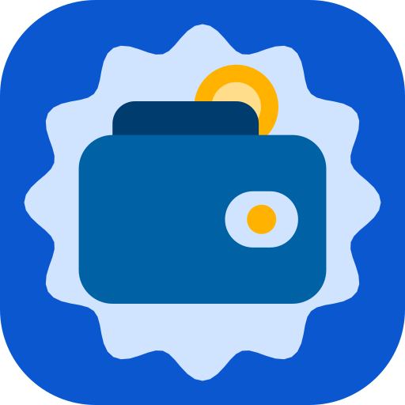

<div align="center">



# Expenser for Android

**Ứng dụng quản lý thu chi cá nhân — Kotlin · Jetpack Compose · Material 3 Expressive**

[](#yêu-cầu)
[](https://kotlinlang.org)
[](https://developer.android.com/jetpack/compose)
[](https://firebase.google.com)

</div>

Expenser là bản native của web app React cùng tên. Ứng dụng dùng **chung Firebase (Authentication + Firestore)** với bản web nên dữ liệu đồng bộ hai chiều, hoạt động **offline-first** và đăng nhập bằng Google.

> Mã nguồn: <https://github.com/minhtrong67/my-kotlin-apps> · Tác giả: [@minhtrong67](https://github.com/minhtrong67)

## Mục lục
- [Tính năng](#tính-năng)
- [Công nghệ](#công-nghệ)
- [Yêu cầu](#yêu-cầu)
- [Bắt đầu nhanh](#bắt-đầu-nhanh)
- [Thiết lập Firebase](#thiết-lập-firebase)
- [Cấu hình `.env`](#cấu-hình-env)
- [Build & phát hành](#build--phát-hành)
- [Cấu trúc dự án](#cấu-trúc-dự-án)
- [Mô hình dữ liệu](#mô-hình-dữ-liệu)
- [Thiết kế giao diện](#thiết-kế-giao-diện)
- [Lịch sử phiên bản](#lịch-sử-phiên-bản)
- [Lưu ý](#lưu-ý)

## Tính năng

**Thu chi**
- Thêm / sửa / xóa giao dịch (thu, chi, chuyển khoản giữa ví); vuốt phải để sửa, vuốt trái để xóa.
- Form thông minh: điền theo thứ tự tùy ý, *Nhập nhanh* gợi ý danh mục + số tiền hay dùng (hiển thị dạng 20K).
- Danh sách và lịch (ô ngày tô màu theo tổng thu chi), bộ lọc theo loại, danh mục, ví, khoảng ngày, từ khóa.
- Quản lý **ví** và **danh mục** (emoji, màu, kéo thả sắp xếp).

**Thống kê & báo cáo**
- Tổng quan tháng, biểu đồ tròn thu / chi theo danh mục với chú thích đầy đủ, top danh mục chi / thu nhiều nhất.
- Xem theo ngày, tuần, tháng, năm, tất cả; xuất báo cáo thành **ảnh PNG 9:16**.

**Cafe recap**
- Ghi lại từng ly cafe: quán, đồ uống, buổi trong ngày, ảnh, đánh giá sao.
- Quán cafe có dạng thẻ lớn (xem ảnh) và dạng danh sách (đầy đủ thông tin, nút **Mở Google Maps**, kéo thả sắp xếp); đồ uống dạng lưới / danh sách.
- Thống kê cafe theo tuần / tháng / năm; xem ảnh toàn màn hình (lightbox vuốt, zoom).
- Tải ảnh từ máy, tự nén và đẩy lên imgbb.

**Nhắc nhở**
- Nhắc ghi chép hằng ngày (chọn giờ), nhắc xem **báo cáo tuần** (Thứ Hai 8:00) và **báo cáo tháng** (ngày 1, 8:00). Chạm thông báo để mở đúng màn hình; tự đặt lại sau khi khởi động lại máy.

**Cài đặt & dữ liệu**
- Tiếng Việt / English, sáng / tối / theo hệ thống, **Material You**, màu nhấn tùy chọn, 3 cỡ chữ.
- Xuất / nhập toàn bộ dữ liệu: JSON, CSV (nén `.zip`) hoặc từng file CSV.
- Hỗ trợ màn hình ngang (navigation rail), vuốt chuyển tab, vuốt phải mở sidebar.

## Công nghệ
| Lớp | Thư viện |
|---|---|
| UI | Jetpack Compose, Material 3 (Expressive), Navigation Compose, Coil |
| Dữ liệu | Firebase Auth, Cloud Firestore (offline), DataStore |
| Đăng nhập | Credential Manager + Google Identity |
| Nền | Coroutines / Flow, AlarmManager (nhắc nhở) |
| Build | Gradle (Kotlin DSL), AGP 8.13, R8, minSdk 26 · targetSdk 35 |

## Yêu cầu
- Android Studio Narwhal (2025.1) trở lên, JDK 17.
- Thiết bị / giả lập Android 8.0 (API 26) trở lên.
- Một dự án Firebase (dùng chung với bản web).

## Bắt đầu nhanh
```bash
git clone https://github.com/minhtrong67/my-kotlin-apps.git
cd my-kotlin-apps/ExpenserAndroid     # thư mục chứa gradlew
```
1. Làm theo [Thiết lập Firebase](#thiết-lập-firebase) và [Cấu hình `.env`](#cấu-hình-env).
2. Mở thư mục bằng Android Studio → *Gradle Sync* → *Run*.
3. Không có cấu hình Firebase, app hiển thị màn hình hướng dẫn thiết lập.

## Thiết lập Firebase
1. Firebase Console → dự án của bản web → *Project settings* → *Add app* → Android, package `com.expenser.app`.
2. Lấy SHA-1: `./gradlew signingReport`, dán vào *SHA certificate fingerprints* (thêm cả SHA-1 khóa release / Play App Signing khi phát hành).
3. *Authentication → Sign-in method* → bật **Google**.
4. Tải `google-services.json` vào `app/`, rồi chạy `powershell -File scripts\make-env.ps1` để chuyển vào `.env`.

## Cấu hình `.env`
Sao chép `.env.example` thành `.env` (đã được git bỏ qua). Biến môi trường thật luôn ưu tiên hơn file.

| Biến | Mô tả |
|---|---|
| `GOOGLE_SERVICES_JSON_BASE64` | Nội dung `google-services.json` dạng Base64; Gradle tự giải mã khi build |
| `KEYSTORE_FILE` / `KEYSTORE_PASSWORD` / `KEY_ALIAS` / `KEY_PASSWORD` | Khóa ký bản release (chưa có thì ký bằng khóa debug) |
| `IMGBB_API_KEY` | Khóa [imgbb](https://api.imgbb.com/) để tải ảnh từ máy lên |

Tạo keystore: `powershell -File scripts\make-keystore.ps1` — **hãy sao lưu keystore và `.env`**, mất chúng sẽ không thể cập nhật app.

## Build & phát hành
```powershell
.\gradlew.bat assembleDebug      # bản debug
.\gradlew.bat assembleRelease    # bản release (R8 + shrink, đã ký)
```
Tên file APK theo quy ước `expenser-<versionName>-<versionCode>-<buildType>.apk`, ví dụ `app/build/outputs/apk/release/expenser-1.12.2-20-release.apk`. Hãy thử hiệu năng trên bản **release** (bản debug của Compose chậm hơn rõ rệt).

## Cấu trúc dự án
```
ExpenserAndroid/
├─ app/src/main/
│  ├─ java/com/expenser/app/
│  │  ├─ data/        Models, Repository (Firestore), SettingsStore, import/export
│  │  ├─ reminder/    ReminderScheduler, receivers (nhắc hằng ngày, báo cáo, boot)
│  │  ├─ ui/          AppRoot (điều hướng), MainViewModel, theme, components, screens
│  │  └─ util/        Format, Periods, ảnh báo cáo, upload ảnh…
│  └─ res/            strings (vi/en), icon adaptive, drawable
├─ scripts/           make-env.ps1, make-keystore.ps1
└─ .env.example
```

## Mô hình dữ liệu
Tương thích hoàn toàn với bản web: `users/{uid}/transactions | categories | wallets | cafeShops | cafeDrinks | cafeLogs`. Ghi theo kiểu offline-first (không chờ server); số dư ví cập nhật bằng `FieldValue.increment`.

## Thiết kế giao diện
- Màu chủ đạo **Material 3 blue**, hỗ trợ màu nhấn tùy chọn và Material You.
- Phong cách **Material 3 Expressive**: góc bo lớn và đa dạng, kiểu chữ nhấn mạnh, chuyển động lò xo (spring) cho FAB, thanh phân đoạn và các thành phần tương tác.
- Icon adaptive 108dp (nền xanh + hình cookie nhiều cánh, ví và đồng xu), có lớp monochrome cho themed icon.

## Lịch sử phiên bản
- **1.12.2** — Số dư còn lại của ngày hiển thị đầy đủ như các dòng giao dịch (vd `+3.000 ₫`) thay vì dạng rút gọn `3k`.
- **1.12.1** — Tiêu đề từng ngày trong danh sách giao dịch (và sheet của lịch) hiển thị số dư còn lại của ngày (thu − chi) thay vì tách thu / chi.
- **1.12.0** — Nâng cấp lên Compose Material 3 1.4 (BOM 2025.09.00), Kotlin 2.2.20, AGP 8.13, Gradle 8.13, compileSdk 36; giữ phong cách Expressive bằng token chuyển động lò xo, shape và typography tự định nghĩa (các API Expressive chính thức chỉ có từ Material 3 1.5).
- **1.11.1** — Áp dụng motion scheme Expressive (spring spatial / effects) cho FAB và thanh phân đoạn; cặp nút Xuất JSON / CSV dạng button group nối liền.
- **1.11.0** — Form quán cafe: đánh giá nằm dưới tên quán; dạng thẻ bỏ kéo thả, dạng danh sách hiển thị đủ thông tin + nút mở Google Maps; logo trong sidebar; link GitHub trong phần Giới thiệu; tinh chỉnh M3 Expressive (shape, typography, spring); viết lại README.
- **1.10.0** — Icon M3 Expressive, tên APK chuẩn, nhắc báo cáo tuần / tháng, rút gọn toàn bộ văn bản, gọn lại màn Cài đặt.
- **1.9.x** — Animation mượt hơn (cuộn lên đầu, tab, accordion), sửa build, form giao dịch, toast, màn ngang.
- **1.8.x** — Upload ảnh imgbb, nhập nhanh, lịch giao dịch, báo cáo ảnh 9:16, màn đăng nhập mới.
- **1.5 – 1.7** — Biểu đồ tròn, xuất / nhập dữ liệu, lightbox, kéo thả sắp xếp, vuốt chuyển tab, nhắc nhở.

## Lưu ý
Mã nguồn được tạo trong môi trường không có Android SDK nên chưa được biên dịch tại chỗ; nếu Gradle báo lỗi, hãy mở issue hoặc gửi log để chỉnh tiếp.

## Tác giả
**minhtrong67** — [github.com/minhtrong67](https://github.com/minhtrong67) · hỗ trợ bởi Claude Sonnet 5.5.
